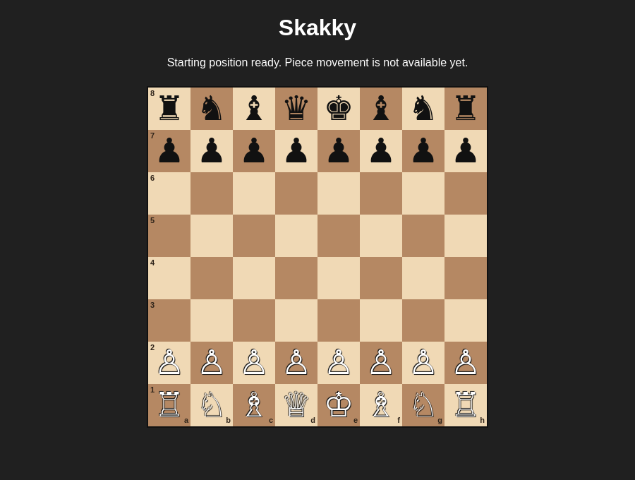

# Skakky
A personal chess project built with HTML, CSS and JavaScript, one small step at a time.

## Current progress

- English page text and document language.
- A responsive 8×8 chessboard with alternating light and dark squares.
- All 32 pieces in their standard starting positions, with White at the bottom.
- File labels (`a`–`h`) and rank labels (`8`–`1`) along the board edges.
- Unicode piece symbols with English accessible names that include their square coordinates.
- Piece movement and game rules are not implemented yet.

## Run locally

Open `index.html` in a web browser on Linux or Windows. No installation or build step is required.

The board is currently a static display. Hover over a square to see its coordinate, such as `a8` or `h1`.
Unicode piece shapes may vary slightly depending on the fonts installed on your system.

## Files

- `index.html` defines the page structure.
- `style.css` defines the page layout and square colors.
- `script.js` creates the 64 squares and displays pieces from an 8×8 array.

## Learning reference

[Chess tutorial on YouTube](https://www.youtube.com/watch?v=SS5amIbX0Mo).
This project is developed in small steps as a personal learning exercise.
